# Desenhos|deepin-draw|

## Visão geral

O Desenhos é uma ferramenta de desenho simples que oferece suporte a rotação, corte, espelhamento, adição de texto, desenho de formas e outros recursos. Você pode fazer edições simples em imagens locais ou criar um desenho do zero.

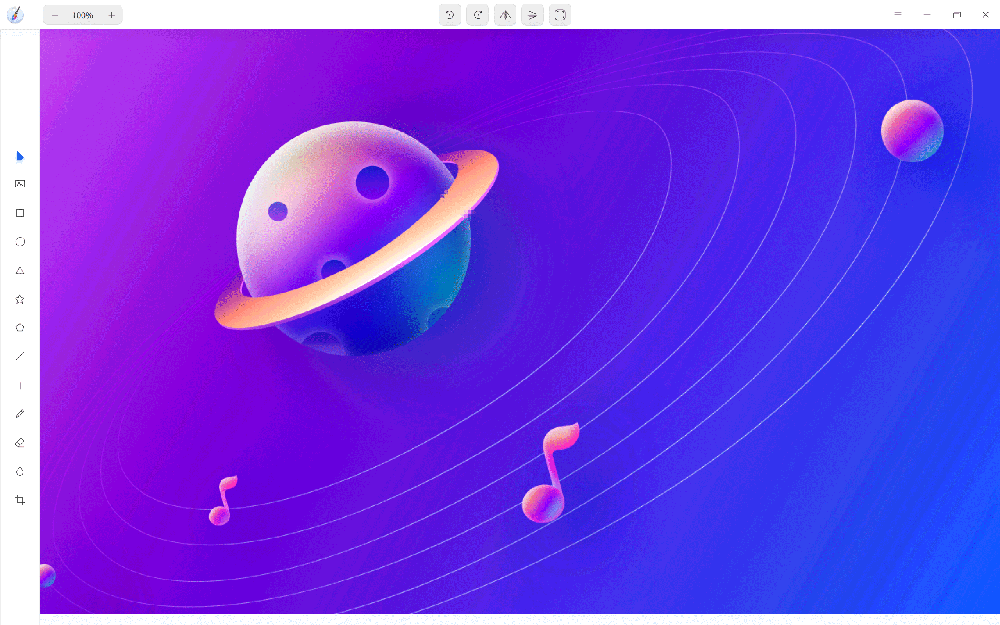

## Primeiros passos

Execute ou feche o Desenhos de uma das formas a seguir, ou crie um atalho para o aplicativo.

### Executar o Desenhos

1. Clique no ícone do inicializador  na barra de tarefas para entrar na interface do inicializador.
2. Role a roda do mouse para cima e para baixo para navegar ou use a pesquisa para localizar o ícone do Desenhos  e clique para executá-lo.
3. Clique com o botão direito em  e você poderá:
 - Clicar em **Enviar para a área de trabalho** para criar um atalho na área de trabalho.
 - Clicar em **Enviar para a barra de tarefas** para fixar o aplicativo na barra de tarefas.
 - Clicar em **Iniciar automaticamente** para adicionar o aplicativo aos itens de inicialização, de modo que ele seja executado automaticamente quando o computador for ligado.

 Dica: você pode definir o Desenhos como o programa padrão de visualização de imagens no Centro de Controle. Para saber mais, consulte [Configurações de programas padrão](dman:///dde#Configurações de programas padrão).

### Fechar o Desenhos

- Na interface do Desenhos, clique em  para sair do aplicativo.
- Na barra de tarefas, clique com o botão direito em  e selecione **Fechar tudo** para sair do aplicativo.
- Na interface do Desenhos, clique em  e selecione **Sair** para fechar o aplicativo.

### Atalhos de teclado

Na interface do Desenhos, use o atalho **Ctrl + Shift + ?** para abrir a tela de visualização de atalhos de teclado. Usar os atalhos com desenvoltura aumentará bastante a sua eficiência.

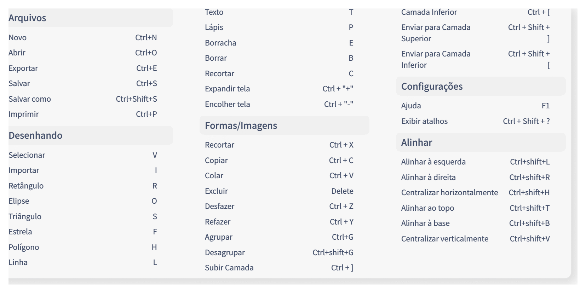

>  Observação: os principais atalhos do Desenhos são: **Ctrl+N** (Novo), **Ctrl+O** (Abrir), **Ctrl+E** (Exportar), **Ctrl+S** (Salvar), **Ctrl+Shift+S** (Salvar como), **Ctrl+P** (Imprimir); ferramentas: **V** (Selecionar), **I** (Importar), **R** (Retângulo), **O** (Elipse), **S** (Triângulo), **F** (Estrela), **H** (Polígono), **L** (Linha), **T** (Texto), **P** (Pincel), **E** (Borracha), **B** (Desfoque), **C** (Cortar); edição: **Ctrl+X** (Recortar), **Ctrl+C** (Copiar), **Ctrl+V** (Colar), **Delete** (Excluir), **Ctrl+Z** (Desfazer), **Ctrl+Y** (Refazer), **Ctrl+G** (Agrupar), **Ctrl+Shift+G** (Desagrupar), **Ctrl+]** (Subir camada), **Ctrl+[** (Descer camada).

## Recursos comuns

Com o Desenhos você pode processar imagens, desenhar formas e exportar em vários formatos de imagem.

### Nova guia

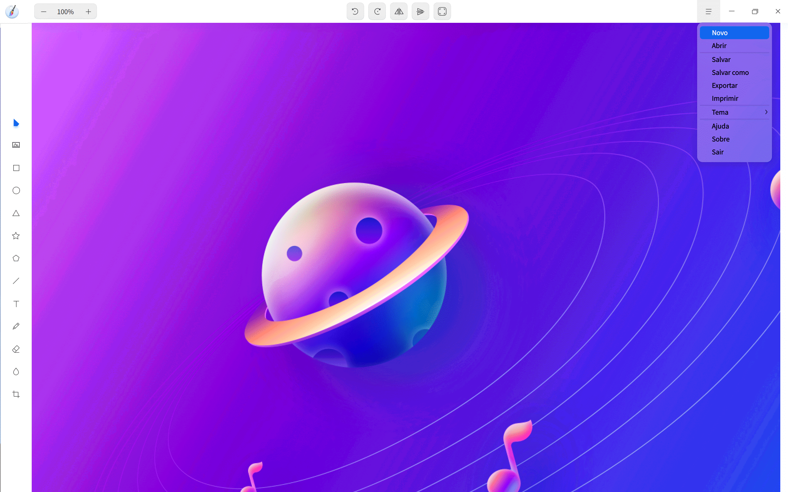

- Na interface do Desenhos, clique em  > **Novo** para criar uma nova guia.
- Quando a janela tiver duas ou mais guias abertas, também é possível clicar no botão  para criar uma nova guia.

### Fechar guia

- Clique com o botão esquerdo em uma guia e, em seguida, clique no botão  para fechá-la.
- Clique com o botão direito em uma guia e selecione **Fechar guia** ou **Fechar outras guias**.

### Abrir imagem

1. Na interface do Desenhos, clique em  ou em  > **Abrir**.

2. Selecione a imagem desejada e clique em **Abrir** para importá-la. Se o tamanho da imagem exceder a área da tela, uma caixa de diálogo será exibida e você poderá optar por manter o tamanho original ou ajustar a imagem ao tamanho da tela.

   Atualmente é possível importar no máximo 30 imagens, nos formatos JPG, PNG, TIF, BMP e DDF.

### Exportar imagem

1. Na interface do Desenhos, clique em  > **Exportar**.

2. Na tela de exportação, é possível configurar o nome do arquivo, o caminho de salvamento, o formato do arquivo e outros parâmetros:

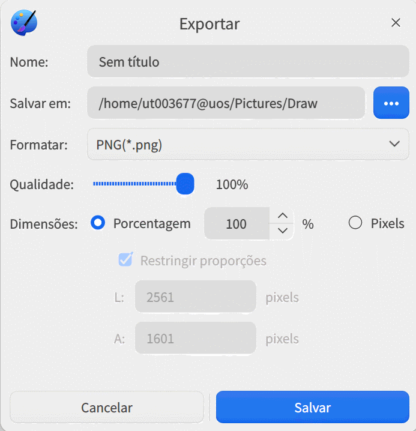

   - Qualidade: ajusta a nitidez da imagem.
   - Dimensões: ajusta a largura e a altura da imagem por porcentagem ou por pixels.
      + Por padrão, a opção **Porcentagem** é selecionada. Você pode definir um valor percentual personalizado e a imagem original será redimensionada proporcionalmente.
      + Ao selecionar **Pixels**, você define valores personalizados de largura e altura e a imagem original é redimensionada de acordo. Se a opção **Restringir proporções** estiver marcada, ao ajustar a largura ou a altura, o outro valor será ajustado automaticamente de forma proporcional.

3. Clique em **Salvar**.

### Salvar imagem

1. Na interface do Desenhos, clique em  > **Salvar** ou  > **Salvar como**.
2. Defina o nome do arquivo e o formato de salvamento.
3. Clique em **Salvar**.

>  Observação: ao salvar um arquivo, a extensão pode ser omitida; o sistema a acrescentará automaticamente ao nome do arquivo.

### Imprimir imagem

1. Na interface do Desenhos, clique em  > **Imprimir**.
2. Selecione a impressora e defina os parâmetros de impressão.
3. Clique em **Imprimir**.

>  Observação: clique em **Configurações avançadas** para personalizar o resultado da impressão.

## Ferramentas de desenho

Com as ferramentas de desenho do Desenhos, você pode dar livre curso à sua imaginação e criatividade para desenhar os mais variados gráficos.

### Ferramenta de formas

1. Na interface do Desenhos, clique em , , ,  ou .
2. Na barra de propriedades, defina os parâmetros da forma:
   - Preenchimento: clique em **Preencher** para definir a cor de preenchimento da forma e a opacidade.
   - Traçado: clique em **Traçado** para definir a cor do contorno da forma e a opacidade.
   - Espessura: no menu suspenso de espessura, defina a espessura do contorno da forma.
   - Pontos/Raio: defina o número de pontos (entre 3 e 50) e o raio (entre 0% e 100%); aplicável apenas à estrela.
   - Lados: defina o número de lados (entre 4 e 10); aplicável apenas ao polígono.

   > Dica: o número de pontos, o raio e o número de lados podem ser ajustados clicando nos botões  ou ; também é possível selecionar o valor e usar as teclas  ou  do teclado ou rolar o mouse para ajustá-los.

3. Arraste o mouse na área da tela para desenhar a forma.

>  Dica: ao desenhar com , , ,  ou , mantenha pressionada a tecla **Shift** ou **Shift + Alt** para desenhar um quadrado, um círculo perfeito, um triângulo equilátero, uma estrela regular ou um polígono regular.

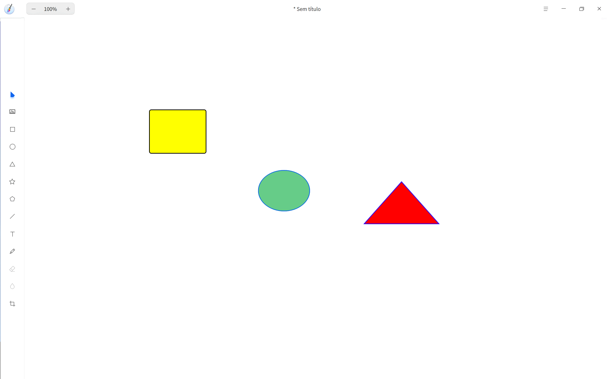

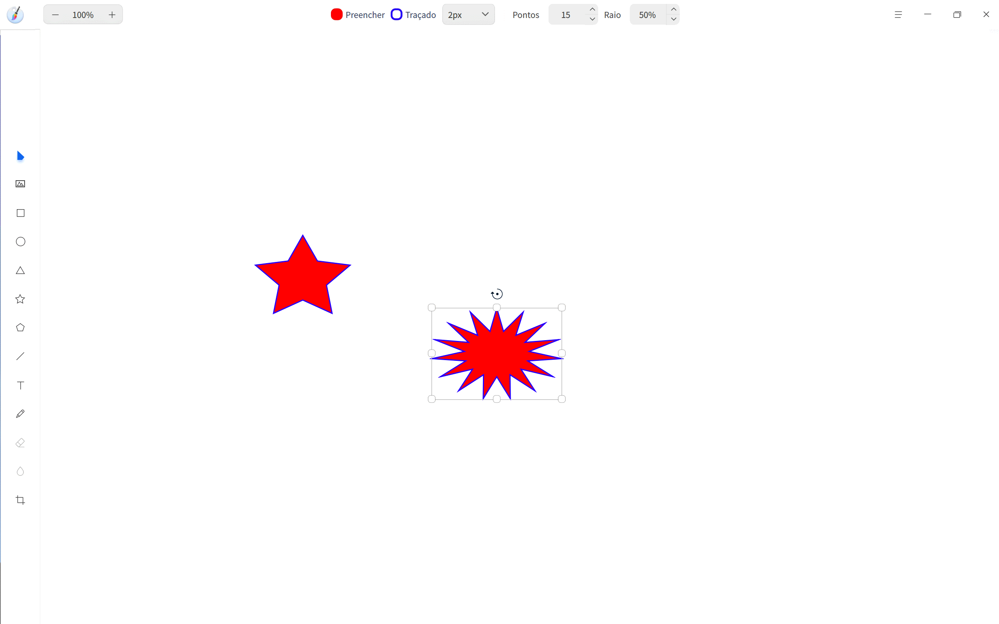

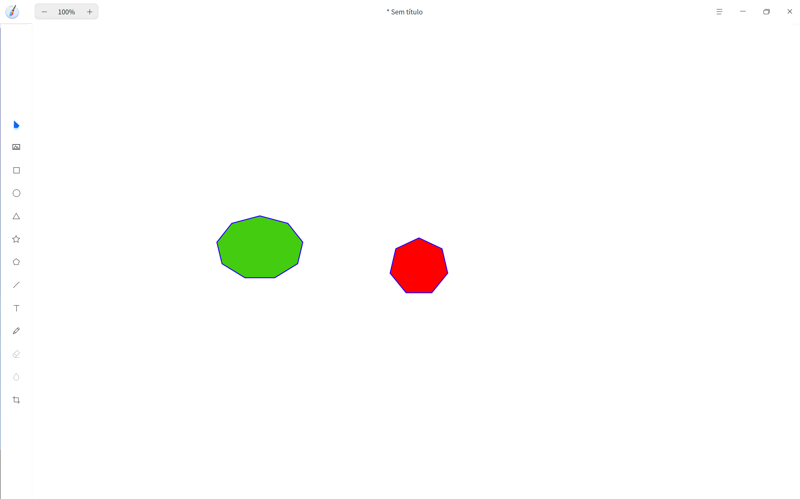

### Ferramenta de linha

1. Na interface do Desenhos, clique em .
2. Na barra de propriedades, defina os parâmetros da linha:
   - Traçado: clique em **Traçado** para definir a cor da linha e a opacidade.
   - Espessura: no menu suspenso de espessura, defina a espessura da linha.
   - Estilo: defina o estilo dos pontos de início (**Início**) e de fim (**Fim**) da linha.
3. Arraste o mouse na área da tela para desenhar a linha.

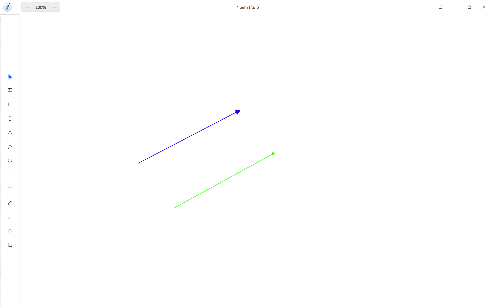

### Ferramenta de texto

1. Na interface do Desenhos, clique em .
2. Na barra de propriedades, defina o estilo do texto:
   - Cor: clique em **Cor** para definir a cor de preenchimento do texto e a opacidade.
   - Fonte: no menu suspenso **Fonte**, selecione o estilo da fonte.
   - Estilo da fonte: defina a fonte normal ou em negrito.
   - Tamanho: no menu suspenso **Tamanho**, selecione o tamanho da fonte.
3. Clique na área da tela e digite o texto na caixa de texto.

> Dica: você também pode usar atalhos de teclado para ajustar o tamanho da fonte: enquanto o texto estiver em edição, clique no valor de tamanho na barra de propriedades e pressione as teclas  ou  para ajustá-lo.

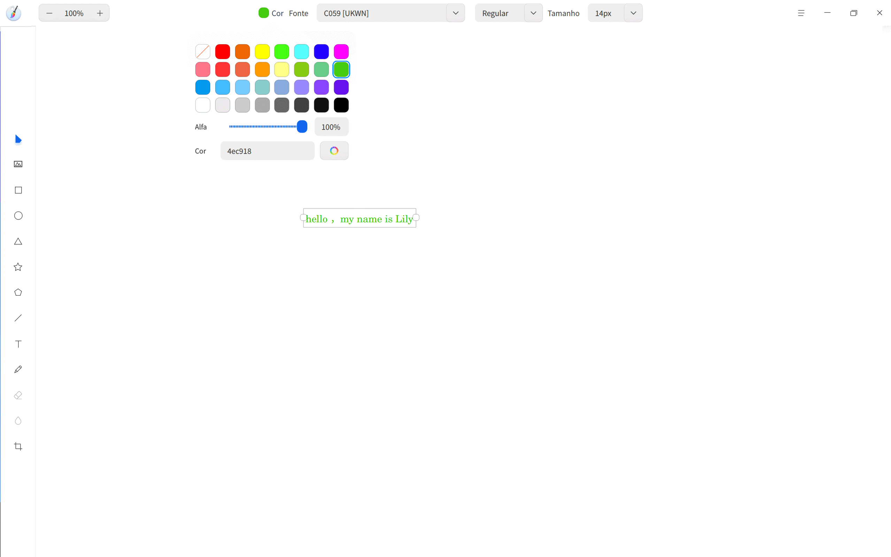

### Ferramenta de pincel

1. Na interface do Desenhos, clique em .
2. Na barra de propriedades, defina os parâmetros do pincel:
   - Traçado: clique em **Traçado** para definir a cor do pincel e a opacidade.
   - Estilo: selecione o estilo de escrita do pincel (por exemplo, **Aquarela**).
   - Espessura: no menu suspenso de espessura, defina a espessura do pincel.
3. Arraste o mouse na área da tela para desenhar.
4. Clique no botão de seleção  da barra de ferramentas para selecionar o desenho e editá-lo.

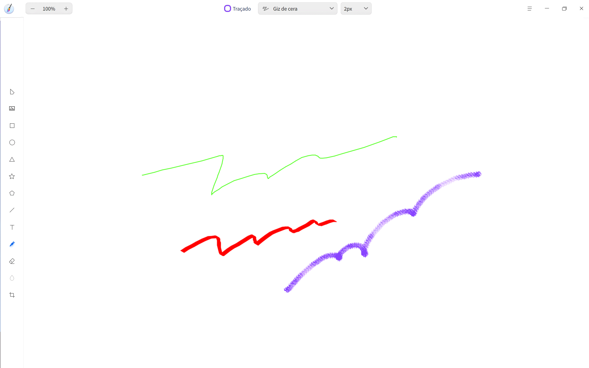

### Ferramenta de borracha

1. Na interface do Desenhos, importe uma imagem ou desenhe um gráfico com a ferramenta de pincel.
2. Clique em .
3. Na barra de propriedades, defina a **Largura** da borracha.
4. Mantenha pressionado o botão esquerdo do mouse e arraste para apagar partes da imagem ou do desenho feito com o pincel.

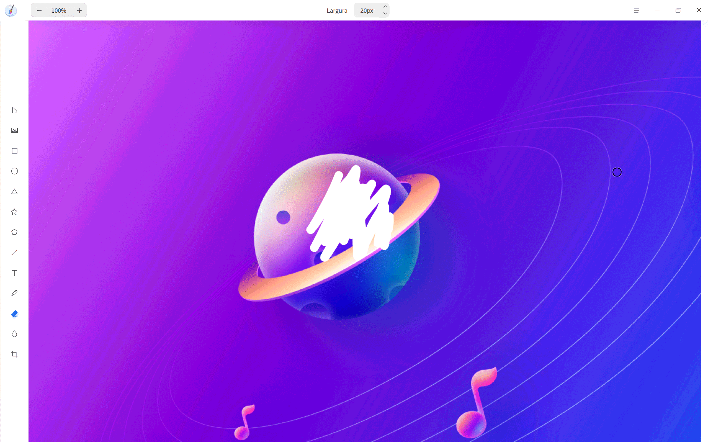

### Ferramenta de desfoque

1. Na interface do Desenhos, importe uma imagem.
2. Clique em .
3. Na barra de propriedades, selecione o tipo de desfoque (desfoque ou mosaico) e defina a **Largura** da área a ser aplicada.
4. Arraste o mouse sobre a imagem para aplicar o efeito na área desejada.

>  Observação: a ferramenta de desfoque funciona apenas em imagens; não tem efeito sobre formas desenhadas.

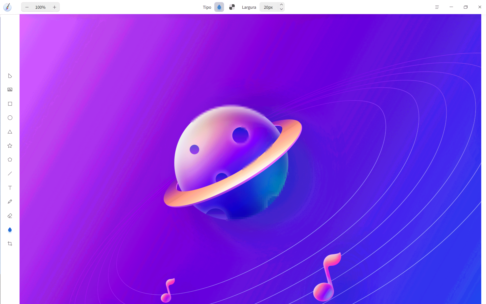

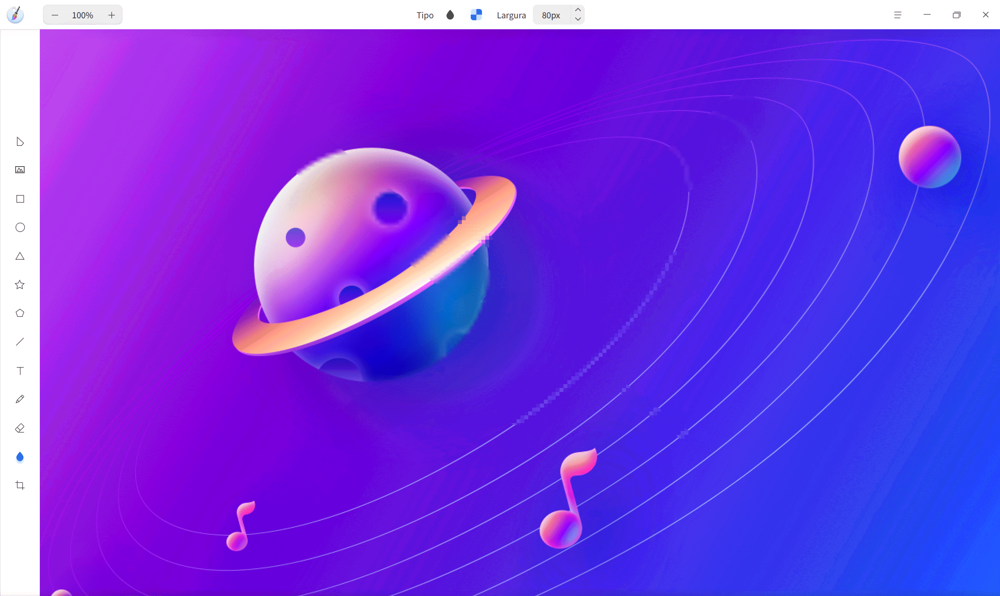

## Recursos de edição

Com os recursos de edição do Desenhos você pode agrupar, cortar, girar e realizar outras operações sobre os gráficos; também é possível ajustar camadas e textos.

### Seleção

Depois de desenhar um gráfico, é possível realizar as seguintes operações:

- Selecionar as formas e os textos já desenhados.
- Arrastar o mouse para criar uma área de seleção em volta dos gráficos; os gráficos dentro da área ficam selecionados.
- Com um gráfico selecionado, arraste as bordas para ajustar seu tamanho.
- Manter pressionada a tecla **Shift** para selecionar vários gráficos.

>  Observação: clique em uma área vazia do Desenhos para cancelar a seleção atual.

### Corte

1. Na interface do Desenhos, clique em .
2. Na barra de propriedades, selecione o modo de corte.
   - Grátis: digite as dimensões manualmente ou arraste as bordas de corte para personalizar a área recortada.
   - Proporção: corte de acordo com uma proporção fixa, como 1:1, 2:3, 8:5 ou 16:9.

3. Pressione a tecla **Enter** do teclado ou clique no ícone  na barra de propriedades para confirmar o corte.

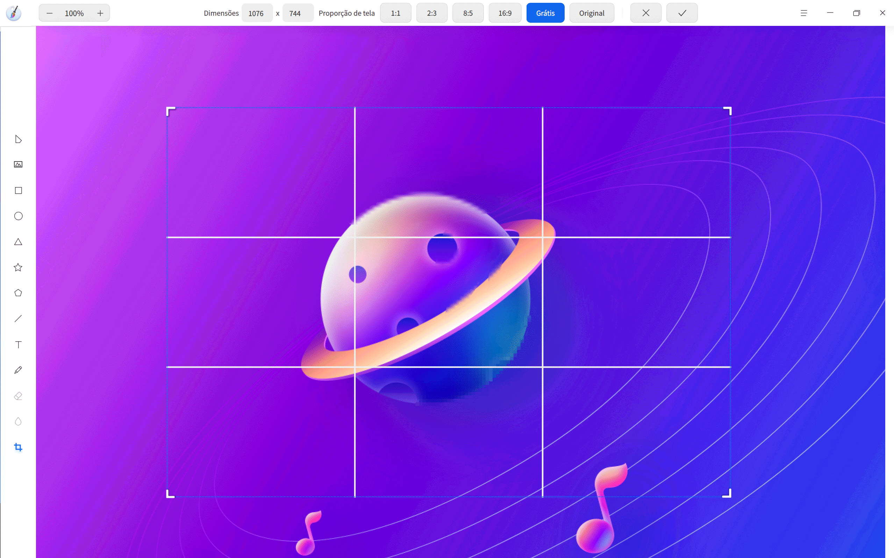

### Espelhar

1. Na interface do Desenhos, selecione a imagem.
2. Clique em  ou  para espelhar a imagem verticalmente ou horizontalmente.

### Girar

1. Na interface do Desenhos, selecione a imagem.
2. Clique em  ou  para girar a imagem 90° no sentido horário ou anti-horário; ou mantenha pressionado o botão de rotação  para girar a imagem livremente.

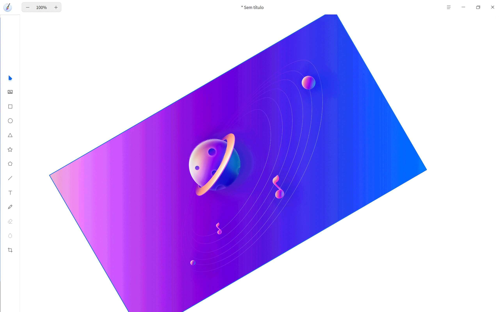

### Ajustar à tela

1. Na interface do Desenhos, selecione a imagem.
2. Clique em  para ajustar o tamanho da tela de acordo com a imagem.
   - Se uma única imagem estiver selecionada, o tamanho da tela será ajustado conforme a largura e a altura da imagem.
   - Se várias imagens estiverem selecionadas, o tamanho da tela será ajustado conforme o maior limite entre elas.

### Agrupar/Desagrupar

1. Na interface do Desenhos, selecione vários gráficos.
2. Clique com o botão direito e selecione **Agrupar**, ou clique no ícone  na barra de propriedades, para agrupar os gráficos.
3. Clique com o botão direito nos gráficos já agrupados e selecione **Desagrupar**, ou clique no ícone  na barra de propriedades, para liberá-los.

>  Dica: você também pode usar os atalhos **Ctrl+G** para agrupar e **Ctrl+Shift+G** para desagrupar.

### Ajustar camadas

1. Na interface do Desenhos, selecione um gráfico.
2. Clique com o botão direito e selecione **Camada** e, em seguida, escolha **Subir Camada**, **Camada Inferior**, **Enviar para Camada Superior** ou **Enviar para Camada Inferior** para ajustar a ordem das camadas.

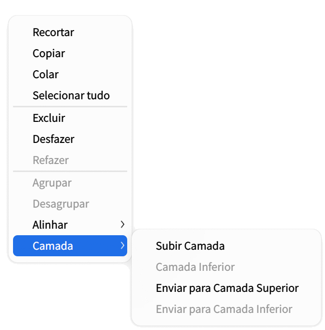

### Alinhar camadas

1. Na interface do Desenhos, selecione um ou vários gráficos.
2. Clique com o botão direito e selecione **Alinhar** e, em seguida, escolha **Alinhar à esquerda**, **Centralizar horizontalmente**, **Alinhar à direita**, **Alinhar ao topo**, **Centralizar verticalmente**, **Alinhar à base**, **Distribuir espaço horizontalmente** ou **Distribuir verticalmente** para ajustar o alinhamento das camadas.

> Observação:
>- Se apenas um gráfico estiver selecionado, ele será alinhado em relação à tela.
>- As opções **Distribuir espaço horizontalmente** e **Distribuir verticalmente** só ficam disponíveis quando três ou mais gráficos estão selecionados.

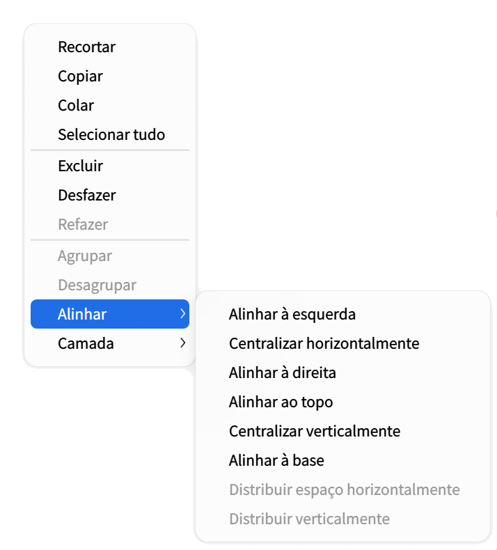

### Alinhar texto

1. Na interface do Desenhos, clique em  e ajuste o tamanho da caixa de texto.
2. Selecione o conteúdo do texto, clique com o botão direito e escolha **Alinhar à esquerda**, **Alinhar à direita** ou **Centralizar** para alinhar o texto.

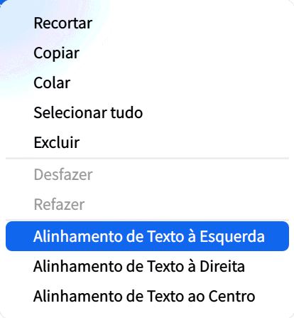

### Copiar e colar

1. Na interface do Desenhos, selecione o gráfico que deseja copiar.
2. Clique com o botão direito e selecione **Copiar**, ou use o atalho **Ctrl + C**, para copiar o gráfico para a área de transferência.
3. Clique com o botão direito e selecione **Colar**, ou use o atalho **Ctrl + V**, para colar o gráfico na tela.

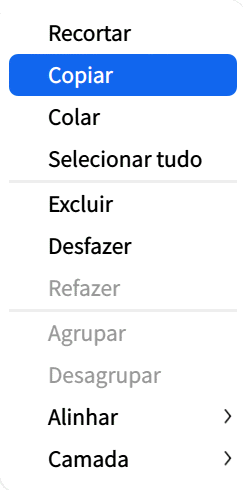

### Excluir

1. Na interface do Desenhos, selecione um gráfico.
2. Clique com o botão direito e selecione **Excluir**, ou pressione a tecla **Delete** do teclado, para excluir o gráfico selecionado.

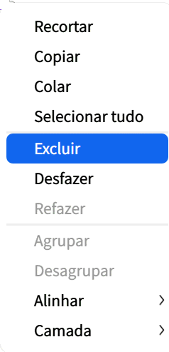

## Menu principal

No menu principal, você pode criar uma nova guia, [abrir imagens](#Abrir-imagem), [exportar imagens](#Exportar-imagem), salvar imagens, imprimir imagens, alternar o tema da janela e consultar o manual de ajuda para conhecer melhor o Desenhos.

### Tema

O tema da janela inclui o tema claro, o tema escuro e o tema do sistema.

1. Na interface do Desenhos, clique em .
2. Selecione **Tema** e escolha uma cor de tema.

### Ajuda

Consulte o manual de ajuda para conhecer melhor o Desenhos e utilizá-lo corretamente.

1. Na interface do Desenhos, clique em .
2. Selecione **Ajuda**.
3. Consulte o manual de ajuda do Desenhos.

### Sobre

1. Na interface do Desenhos, clique em .
2. Selecione **Sobre**.
3. Consulte a versão e a descrição do Desenhos.

### Sair

1. Na interface do Desenhos, clique em .
2. Selecione **Sair**.
